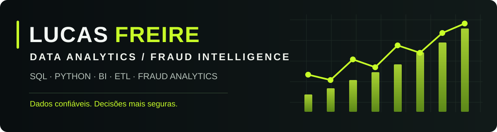
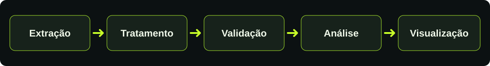

### Transformando dados em decisões mais seguras.

**Análise de Dados · Prevenção a Fraudes · Business Intelligence**

---

## Sobre mim

Atuo na interseção entre **análise de dados, automação e prevenção a fraudes**. Tenho experiência com análise de risco em operações financeiras, incluindo PIX, TED, boletos, onboarding e KYC, além de projetos práticos que transformam dados operacionais em informações utilizáveis.

Meu foco técnico envolve **SQL, Python, Pandas, PostgreSQL e Business Intelligence**, com atenção à integridade, rastreabilidade, qualidade dos dados e comunicação de insights.

## Stack e ferramentas

## Projetos em destaque

| Projeto | Objetivo | Tecnologias / temas |
|:--|:--|:--|
| **[Fraud Analytics SQL](https://github.com/lucasfrmg25-del/fraud-analytics-sql)** | Explorar padrões transacionais e indicadores de risco | SQL · Fraud Analytics |
| **[Fraud Analytics ML](https://github.com/lucasfrmg25-del/Fraud-Analytics-ML)** | Exploração de métodos de análise e modelagem de fraudes | Python · Machine Learning |
| **[Triagem PIX](https://github.com/lucasfrmg25-del/Triagem_PIX)** | Filtrar transações e identificar operações prioritárias | Python · Análise de risco |
| **[Automação de Extrato de Boletos](https://github.com/lucasfrmg25-del/Automa-o-de-Extrato-de-Boletos)** | Automatizar tratamento de dados de boletos | Python · PDF · Automação |
| **[we_clean_CSV](https://github.com/lucasfrmg25-del/we_clean_CSV)** | Trabalhar com limpeza e preparação de arquivos | Dados · Qualidade |

## Meu fluxo de trabalho

**Princípios:** qualidade dos dados · validação · reprodutibilidade · rastreabilidade · métricas claras.

## Áreas de interesse

- **Fraud Analytics:** monitoramento transacional, alertas, padrões de risco e falsos positivos.
- **Engenharia e preparação de dados:** extração, ETL, limpeza, padronização e integração.
- **Business Intelligence:** KPIs, dashboards, modelagem analítica e storytelling.

---

Construindo soluções analíticas com foco em clareza, integridade e impacto.

